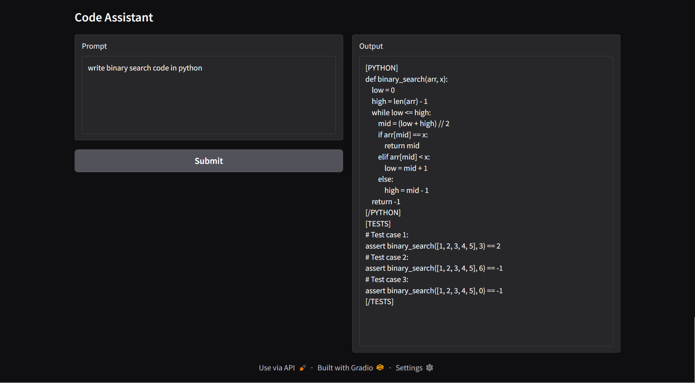

# Code Assistant - AI-Powered Code Teaching Assistant

## Overview
**Code Assistant** is an AI-powered coding assistant that provides intelligent responses to programming-related queries. Built using **Gradio** for a user-friendly interface and a custom **CodeAssist** model, this tool is designed to help developers, learners, and enthusiasts understand and generate code efficiently.  

This project maintains conversation **history** to provide context-aware responses, making interactions more natural and productive.

---

## Features
- Interactive **web interface** built with Gradio
- Context-aware **conversation history**
- Supports **multiple programming languages**
- Streamlined API integration for AI code responses
- Configurable **system prompts** and **temperature** for AI behavior

---
[reference ollama link ](https://github.com/ollama/ollama)

---
## 📸 Application Screenshots (Streamlit UI)
